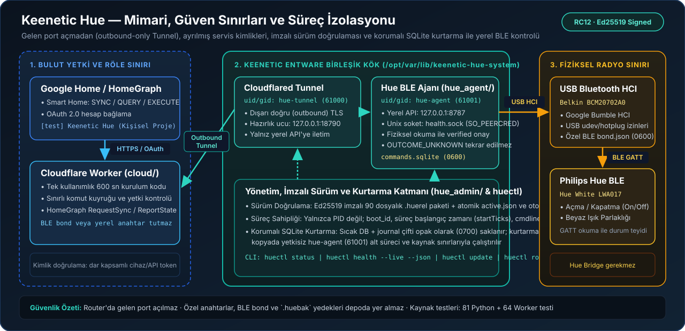

# Keenetic Hue

**Bring a Hue BLE lamp to Google Home through your Keenetic router.**

[Türkçe ana sayfa](README.md) · [Installation](docs/installation.md) · [Security](SECURITY.md) · [Release notes](docs/releases/0.2.0-rc.12.md)

An Entware agent controls a Hue BLE lamp through a USB Bluetooth adapter.
A Cloudflare Worker handles personal Google Home account linking and commands.
An outbound Tunnel connects it to the router without opening an inbound port.
BLE pairing keys and local API credentials stay on the router.

## Status and compatibility

RC12 passed live acceptance on the existing personal installation: verified
commands, reboot/automatic startup and matching HomeGraph state. Tested hardware
is Hue White **LWA017**, Belkin **BCM20702A0**, and Keenetic/Entware
**mips-3.4 / CPython 3.13**. Dependencies are [pinned](requirements-router.lock.json).

This is a personal integration, not a certified Google product or a universal
Hue Bridge replacement. Different hardware and fresh-account cloud setup require
their own validation. Only on/off and white-light brightness are in the tested
scope; no Matter, color or audio support is claimed.

## Start with the correct path

1. Read [USB, Entware and dependency prerequisites](docs/reinstall.md).
2. Follow [signed installation](docs/installation.md).
3. Set up your [cloud resources](docs/cloud-rebuild.md) and [Google Home linking](docs/google-home.md).
4. For the same existing installation, use your encrypted personal backup and
   the documented [restore path](docs/backup-restore.md).

The detailed operational guides are currently in Turkish. A new lamp/adapter
needs its own BLE pairing and private configuration. An entirely new cloud
account is not an accepted turnkey installation. Example configuration is not
ready-to-run configuration, and the archive contains no personal credentials.

## Design and contribution

Separate service identities, bounded command/retry queues, signed releases and
encrypted backups protect operational boundaries. Uncertain physical commands
are not automatically replayed. Hot SQLite pairs are preserved before bounded
recovery of a staged copy under the dedicated agent identity.

[Architecture](docs/architecture.md) · [Contributing](CONTRIBUTING.md) · [Support](SUPPORT.md)

Project code is [MIT licensed](LICENSE). Third-party components retain their own
[licenses](THIRD_PARTY_NOTICES.md). Product names belong to their respective
owners; no affiliation or endorsement is implied.
