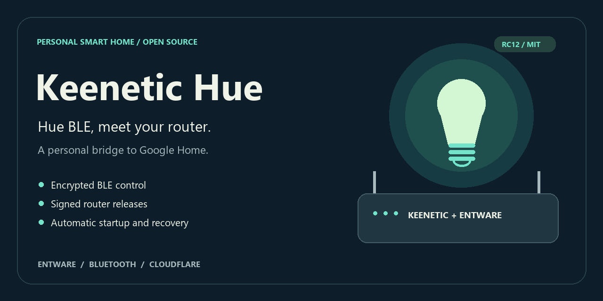
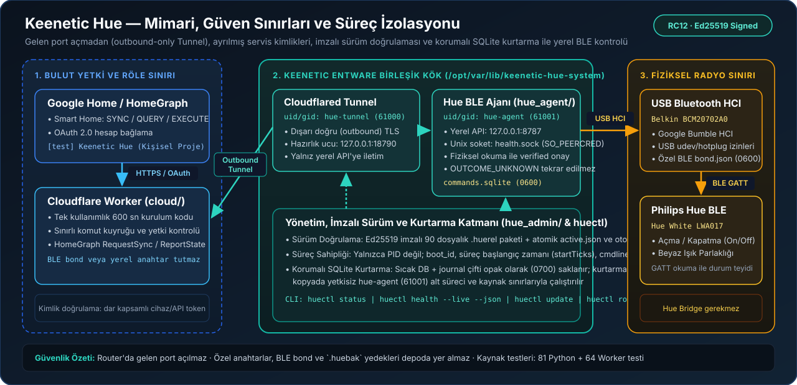

# Keenetic Hue



**Control a Philips Hue BLE lamp from Google Home through your Keenetic router—without a Hue Bridge and without opening inbound ports.**

[Türkçe özet](README.tr.md) · [Installation](docs/installation.md) · [Architecture](docs/architecture.md) · [Security](SECURITY.md) · [RC17 Release Notes](docs/releases/0.2.0-rc.17.md) · [Repository Design Research](docs/repository-design.md)

> **Status (`v0.2.0-rc.17`):** Release candidate that passed live `huectl status --json` and `huectl health --live --json` acceptance (`healthy: true`, `bootstrapInSync: true`) on the documented personal hardware profile on 14 November 2026. This is a personal systems integration—not a Google-certified commercial product or a universal Hue Bridge replacement. Different hardware and fresh Google/Cloudflare accounts require independent validation.

---

## Why Keenetic Hue?

Controlling a single Bluetooth Low Energy (BLE) Hue bulb remotely via Google Home typically forces a choice between buying a dedicated Zigbee bridge or exposing an always-on home server. **Keenetic Hue** runs directly on an always-on Keenetic router's USB/Entware environment with strict operational and privilege boundaries:

| Engineering Dimension | Typical DIY / Bridge Setup | Keenetic Hue Approach |
| --- | --- | --- |
| **Network Surface** | Inbound port forwarding or full-network VPN | **Zero inbound ports:** Router-initiated outbound Cloudflare Tunnel + scoped Cloudflare Worker |
| **Credential Isolation** | Cloud tokens and BLE keys co-located in one runtime | **Strict trust split:** OAuth & HomeGraph stay in the Worker; BLE bond keys and local API tokens (`0600`) never leave the router |
| **Privilege Separation** | Single monolithic daemon running as `root` | **Dedicated principals:** BLE agent runs as `hue-agent` (`61001`), tunnel as `hue-tunnel` (`61000`), verified via `SO_PEERCRED`, `boot_id`, and `startTicks` |
| **Physical Command Safety** | Blind retries on network timeouts (causing unintended bulb toggling) | **No blind replay:** Commands unconfirmed by a physical GATT read are recorded as `OUTCOME_UNKNOWN` and never auto-replayed |
| **Crash Recovery** | Opening or deleting corrupted SQLite journals directly as `root` | **Staged opaque recovery:** Hot `commands.sqlite` + journal pairs are preserved under `0700`; recovery runs on a staged copy under the unprivileged `hue-agent` identity |
| **Updates & Rollback** | Manual `scp` file overwrites | **Ed25519-signed `.huerel` bundles:** Atomic slot switching (`active.json`), live health gates, and automatic `rollback` on failure |

---

## Architecture & Trust Boundaries



A Cloudflare Worker handles personal Google Home OAuth linking and Smart Home intents (`SYNC`, `QUERY`, `EXECUTE`), communicating with the router over an outbound-only Cloudflare Tunnel. On the router, `hue_admin` supervises isolated `hue-tunnel` and `hue-agent` processes while `hue_agent` drives the USB Bluetooth HCI adapter via Google Bumble. Detailed threat and boundary model: **[Architecture & Trust Boundaries](docs/architecture.md)**.

---

## Feature – Module – Test Traceability

Every core capability and security boundary in the repository maps directly to its implementation module and portable verification test:

| Capability / Security Boundary | Source Module | Verification Test |
| --- | --- | --- |
| **BLE GATT control & physical readback verification (`verified` / `OUTCOME_UNKNOWN`)** | [`hue_agent/agent.py`](hue_agent/agent.py), [`hue_agent/lamp.py`](hue_agent/lamp.py), [`hue_agent/bumble_io.py`](hue_agent/bumble_io.py) | [`tests/test_agent.py`](tests/test_agent.py), [`tests/test_core.py`](tests/test_core.py) |
| **Bounded staged SQLite recovery (retaining original DB/journal pair)** | [`hue_admin/agent_storage.py`](hue_admin/agent_storage.py), [`hue_admin/agent_runtime.py`](hue_admin/agent_runtime.py) | [`tests/test_sqlite_crash_recovery.py`](tests/test_sqlite_crash_recovery.py), [`tests/test_agent_recovery.py`](tests/test_agent_recovery.py) |
| **Dedicated service identities (`hue-agent`, `hue-tunnel`) & process ownership (`boot_id` + `startTicks`)** | [`hue_admin/privileges.py`](hue_admin/privileges.py), [`hue_admin/service_manager.py`](hue_admin/service_manager.py), [`hue_admin/child_identity.py`](hue_admin/child_identity.py) | [`tests/test_privilege_boundary.py`](tests/test_privilege_boundary.py), [`tests/test_agent_process_identity.py`](tests/test_agent_process_identity.py) |
| **Unified health probe (`SO_PEERCRED` Unix socket & component ownership)** | [`hue_admin/unified_health.py`](hue_admin/unified_health.py), [`hue_admin/health.py`](hue_admin/health.py) | [`tests/test_unified_health.py`](tests/test_unified_health.py), [`tests/test_health_peer.py`](tests/test_health_peer.py) |
| **Ed25519-signed `.huerel` packaging, bootstrap & atomic rollback** | [`deploy/build_release.py`](deploy/build_release.py), [`deploy/install_release.py`](deploy/install_release.py), [`hue_admin/releases.py`](hue_admin/releases.py) | [`tests/test_build_release.py`](tests/test_build_release.py), [`tests/test_update.py`](tests/test_update.py) |
| **Encrypted password-protected backups (`.huebak`) & transactional restore** | [`hue_admin/backup.py`](hue_admin/backup.py), [`hue_admin/restore.py`](hue_admin/restore.py), [`hue_admin/restore_transaction.py`](hue_admin/restore_transaction.py) | [`tests/test_backup_restore.py`](tests/test_backup_restore.py), [`tests/test_restore_transaction.py`](tests/test_restore_transaction.py) |
| **Google Home Smart Home intents, OAuth 2.0 & HomeGraph reporting** | [`cloud/src/index.ts`](cloud/src/index.ts), [`cloud/src/google-home.ts`](cloud/src/google-home.ts), [`cloud/src/homegraph.ts`](cloud/src/homegraph.ts) | [`cloud/test/google-home.test.ts`](cloud/test/google-home.test.ts), [`cloud/test/homegraph.test.ts`](cloud/test/homegraph.test.ts) |

---

## Verified Hardware & Runtime Profile

| Component | Accepted Configuration |
| --- | --- |
| **Lamp** | Philips Hue White **LWA017** — BLE, on/off and white-light brightness |
| **Bluetooth Adapter** | Belkin **BCM20702A0** USB HCI dongle (driven via Google Bumble user-space stack) |
| **Router Environment** | Keenetic with Entware on ext4 USB storage (`mips-3.4`) |
| **Runtime** | CPython **3.13** with exact hashes pinned in [`requirements-router.lock.json`](requirements-router.lock.json) |
| **Cloud Layer** | Personal Cloudflare Worker + Tunnel and Google Home developer project (`[test] Keenetic Hue`) |

> **Scope Boundary:** Color temperature/RGB, Matter, Zigbee/Hue Bridge, and audio streaming are outside the verified scope of this project.

---

## Three-Stage Setup & Verification Summary

### 1. Pre-installation
- Prepare `ext4` USB storage on the Keenetic router, a working Entware environment, and the pinned dependencies in [`requirements-router.lock.json`](requirements-router.lock.json) ([preparation steps](docs/reinstall.md#2-preparing-entware)).
- Obtain the signed `keenetic-hue-0.2.0-rc.17.huerel` bundle, the independently verified [`keys/release-trust.pub`](keys/release-trust.pub) public key (`SHA-256: 3eb6abbce938c6f75054da02ecca3cb291f576ef0633b5de54dd78fa2cd8a4be`), and the standalone [`deploy/install_release.py`](deploy/install_release.py) installer.

### 2. Signed Installation & Configuration
- **Fresh signed installation on Entware:** Follow [Installation & file layout](docs/installation.md) (`sha256sum -c` + `python3 -I install_release.py`).
- **Restore existing hardware from an encrypted backup (`.huebak`):** Follow [Reinstall after USB loss](docs/reinstall.md) and [Encrypted backup & restore](docs/backup-restore.md).
- **Cloud & Google Home setup:** Follow [Cloud rebuild & recovery](docs/cloud-rebuild.md) and [Google Home account linking](docs/google-home.md). *(The software bundle contains no personal credentials or BLE bond keys; [`config.example.json`](config.example.json) is a structural schema example only.)*

### 3. Post-installation Verification
Run the read-only live health check in an interactive Entware SSH terminal:

```sh
huectl status
huectl health --live --json
```

Expected sanitized output when both dedicated service principals, the local API, the BLE link, and the outbound Tunnel are verified:

```json
{
  "schemaVersion": 1,
  "healthy": true,
  "releaseId": "0.2.0-rc.17",
  "components": {
    "agent":     { "state": "running", "reason": "OWNED_VERSION" },
    "tunnel":    { "state": "ready",   "reason": "TUNNEL_READY" },
    "manager":   { "state": "running", "reason": "BOTH_COMPONENTS_OWNED" },
    "localApi":  { "state": "ready",   "reason": "API_RESPONSE" },
    "ble":       { "state": "ready",   "reason": "VERIFIED" },
    "reporting": { "state": "unknown", "reason": "NOT_CHECKED" }
  },
  "principals": {
    "agent":  { "expectedUid": 61001, "expectedGid": 61001 },
    "tunnel": { "expectedUid": 61000, "expectedGid": 61000 }
  }
}
```

---

## Task-Oriented Guides

| Task | Guide |
| --- | --- |
| Install the signed release onto a clean Entware root | [Installation & file layout](docs/installation.md) |
| Migrate to a new USB drive with the same adapter and lamp | [Reinstall after USB/Entware loss](docs/reinstall.md) |
| Provision or recover Cloudflare Worker, Tunnel, and Google Home resources | [Cloud rebuild & recovery](docs/cloud-rebuild.md) |
| Link a Google Home account or issue a one-time setup code | [Google Home account linking](docs/google-home.md) |
| Check health, create encrypted backups, or apply updates | [Daily maintenance quickstart](docs/maintenance-quickstart.md) |
| Understand signed updates, atomic rollback, and repair receipts | [Signed updates, repair & rollback](docs/update-rollback.md) |
| Diagnose a degraded component, offline state, or SQLite checkpoint stop | [Troubleshooting](docs/troubleshooting.md) |
| Prepare the optional RAM-based USB filesystem maintenance helper | [RAM storage maintenance helper](docs/storage-maintenance.md) |

---

## Local Verification, Contributing & License

Run offline publication hygiene checks and portable unit tests on a workstation:

```sh
python tools/check_publication.py
python tools/run_portable_tests.py
cd cloud && npm run typecheck && npm test
```

> Portable tests (91 portable Python tests out of 566 total Python tests including native Linux/POSIX/root checks, plus 70 Cloudflare Worker tests) verify protocol and state-machine contracts; they do not replace physical BLE radio, router, and live Cloudflare Worker/HomeGraph acceptance. See [Contributing](CONTRIBUTING.md) and [Changelog](CHANGELOG.md).

Never include tokens, private keys, BLE bonds, setup codes, or `.huebak` archives in bug reports.  
[Security Policy](SECURITY.md) · [Support](SUPPORT.md) · [Repository Design Research](docs/repository-design.md) · [Türkçe Özet](README.tr.md)

Project code is [MIT licensed](LICENSE). Third-party components retain their own licenses; see [Third-Party Notices](THIRD_PARTY_NOTICES.md) and [`THIRD_PARTY_LICENSES.txt`](THIRD_PARTY_LICENSES.txt). Product names belong to their respective owners; no affiliation or endorsement is implied.
