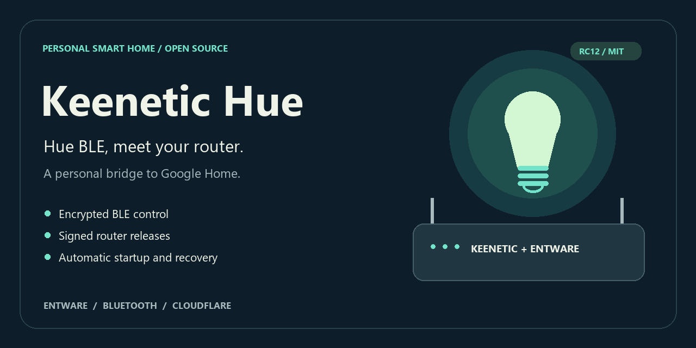
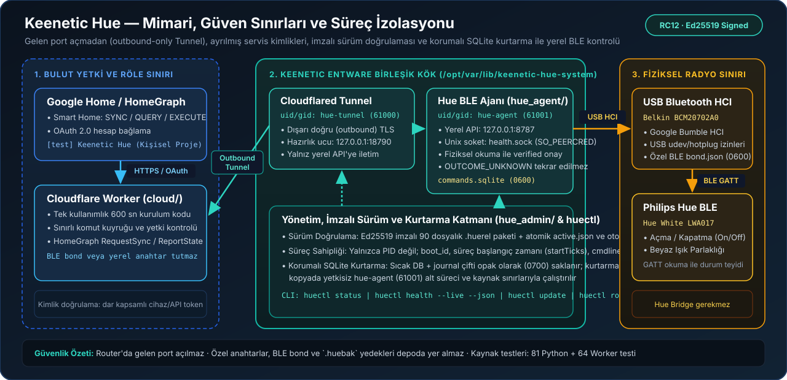

# Keenetic Hue



**Philips Hue BLE lambanı ayrı bir Hue Bridge veya gelen port açmadan, Keenetic router üzerindeki imzalı ve izole Entware ajanıyla Google Home'a bağla.**

[English (Default)](README.md) · [Installation](docs/installation.md) · [Architecture](docs/architecture.md) · [Security](SECURITY.md) · [RC19 Release Notes](docs/releases/0.2.0-rc.19.md) · [Repository Design Research](docs/repository-design.md)

> **Durum (`v0.2.0-rc.19`):** Belgelenen kişisel donanım profilinde 14 Kasım 2026 tarihinde canlı `huectl status --json` ve `huectl health --live --json` kabulünü geçmiş aday sürüm (`healthy: true`, `bootstrapInSync: true`). Evrensel bir Hue Bridge ikamesi veya Google sertifikalı ticari ürün değildir; farklı donanımlar ve sıfırdan açılan Google/Cloudflare hesapları ayrı doğrulama gerektirir.

---

## Neden Keenetic Hue? (`Why`)

Tek bir Bluetooth Low Energy (BLE) Hue ampulü uzaktan ve Google Home üzerinden yönetmek istediğinizde standart seçenekler ya ek bir fiziksel köprü (Hue Bridge) satın almayı ya da ev ağına gelen (inbound) port açıp genel amaçlı bir ev otomasyon sunucusu kurmayı gerektirir. **Keenetic Hue**, evde zaten 7/24 açık duran Keenetic router'ın USB portunu ve Entware ortamını savunmacı bir sistem mühendisliği yaklaşımıyla kullanır:

| Tasarım Boyutu | Tipik Hobi / Köprü Kurulumu | Keenetic Hue Yaklaşımı |
| --- | --- | --- |
| **Ağ Yüzeyi** | Router'da gelen port açma veya tam ağ erişimli VPN | **Gelen port açılmaz:** Yalnızca router'dan dışarı doğru (`outbound`) kurulan Cloudflare Tunnel ve dar kapsamlı Worker |
| **Anahtar ve Kimlik Sınırı** | Bulut ve yerel anahtarların aynı süreçte/ortamda tutulması | **Sıkı ayrım:** OAuth ve HomeGraph bulutta; BLE bond anahtarı ve yerel API sırları (`0600`) yalnızca router üzerinde kalır |
| **Süreç İzolasyonu** | Tüm servislerin `root` olarak tek süreçte çalışması | **Ayrılmış servis kimlikleri:** BLE ajanı `hue-agent` (`61001`), tünel `hue-tunnel` (`61000`) kimliğiyle çalışır; `SO_PEERCRED` ve `boot_id` doğrulanır |
| **Fiziksel Komut Güvenliği** | Ağ zaman aşımında komutu körü körüne tekrar gönderme (lamba yanıp sönmesi) | **Belirsiz komut koruması:** Fiziksel GATT okumasıyla doğrulanamayan komut `OUTCOME_UNKNOWN` olarak kaydedilir ve otomatik tekrarlanmaz |
| **Veritabanı Kurtarma** | Ani güç kesintisinde bozulan SQLite dosyasını `root` ile doğrudan açma veya silme | **Opak ikili koruma:** Özgün `commands.sqlite` + `journal` çifti `0700` altında saklanır; kurtarma yalnızca geçici kopyada yetkisiz ajan kimliğiyle yapılır |
| **Güncelleme ve Geri Dönüş** | Elle dosya kopyalama (`scp`) ve bozulduğunda sıfırdan kurulum | **Ed25519 imzalı `.huerel` paketi:** Atomik sürüm seçimi (`active.json`), sağlık doğrulaması ve başarısızlıkta otomatik `rollback` |

---

## Mimari ve Güven Sınırları



OAuth hesap bağlama ve Google HomeGraph bildirimleri Cloudflare Worker katmanında; BLE GATT iletişimi, komut günlüğü ve donanım kilidi Keenetic üzerinde kalır. Ayrıntılı süreç ve hata modeli için: **[Architecture & Trust Boundaries](docs/architecture.md)**.

---

## Özellik – Kaynak Kod – Doğrulama Testi İzlenebilirliği

Depodaki her temel yetenek doğrudan ilgili modüle ve taşınabilir doğrulama testine bağlıdır:

| Yetenek / Güvenlik Sınırı | Kaynak Modül | Doğrulama Testi |
| --- | --- | --- |
| **BLE GATT kontrolü ve fiziksel durum doğrulaması (`verified` / `OUTCOME_UNKNOWN`)** | [`hue_agent/agent.py`](hue_agent/agent.py), [`hue_agent/lamp.py`](hue_agent/lamp.py), [`hue_agent/bumble_io.py`](hue_agent/bumble_io.py) | [`tests/test_agent.py`](tests/test_agent.py), [`tests/test_core.py`](tests/test_core.py) |
| **Korumalı SQLite kurtarma (özgün DB/journal koruma + yetkisiz alt süreç)** | [`hue_admin/agent_storage.py`](hue_admin/agent_storage.py), [`hue_admin/agent_runtime.py`](hue_admin/agent_runtime.py) | [`tests/test_sqlite_crash_recovery.py`](tests/test_sqlite_crash_recovery.py), [`tests/test_agent_recovery.py`](tests/test_agent_recovery.py) |
| **Ayrılmış servis kimlikleri (`hue-agent`, `hue-tunnel`) ve süreç sahipliği (`boot_id` + `startTicks`)** | [`hue_admin/privileges.py`](hue_admin/privileges.py), [`hue_admin/service_manager.py`](hue_admin/service_manager.py), [`hue_admin/child_identity.py`](hue_admin/child_identity.py) | [`tests/test_privilege_boundary.py`](tests/test_privilege_boundary.py), [`tests/test_agent_process_identity.py`](tests/test_agent_process_identity.py) |
| **Birleşik sağlık sorgusu (`SO_PEERCRED` Unix soketi ve bileşen doğrulaması)** | [`hue_admin/unified_health.py`](hue_admin/unified_health.py), [`hue_admin/health.py`](hue_admin/health.py) | [`tests/test_unified_health.py`](tests/test_unified_health.py), [`tests/test_health_peer.py`](tests/test_health_peer.py) |
| **Ed25519 imzalı `.huerel` paketleme, kurulum ve atomik geri alma (`rollback`)** | [`deploy/build_release.py`](deploy/build_release.py), [`deploy/install_release.py`](deploy/install_release.py), [`hue_admin/releases.py`](hue_admin/releases.py) | [`tests/test_build_release.py`](tests/test_build_release.py), [`tests/test_update.py`](tests/test_update.py) |
| **Parola korumalı şifreli yedek (`.huebak`) ve atomik geri yükleme** | [`hue_admin/backup.py`](hue_admin/backup.py), [`hue_admin/restore.py`](hue_admin/restore.py), [`hue_admin/restore_transaction.py`](hue_admin/restore_transaction.py) | [`tests/test_backup_restore.py`](tests/test_backup_restore.py), [`tests/test_restore_transaction.py`](tests/test_restore_transaction.py) |
| **Google Home Smart Home (`SYNC`/`QUERY`/`EXECUTE`), OAuth 2.0 ve HomeGraph** | [`cloud/src/index.ts`](cloud/src/index.ts), [`cloud/src/google-home.ts`](cloud/src/google-home.ts), [`cloud/src/homegraph.ts`](cloud/src/homegraph.ts) | [`cloud/test/google-home.test.ts`](cloud/test/google-home.test.ts), [`cloud/test/homegraph.test.ts`](cloud/test/homegraph.test.ts) |

---

## Doğrulanan Donanım ve Ortam Profili

| Bileşen | Kabul Edilen Kurulum |
| --- | --- |
| **Lamba** | Philips Hue White **LWA017** — BLE, açma/kapatma ve beyaz ışık parlaklığı |
| **Bluetooth Adaptörü** | Belkin **BCM20702A0** USB HCI adaptörü (Google Bumble kullanıcı alanı yığını ile) |
| **Router Ortamı** | Keenetic + ext4 USB depolama üzerinde Entware (`mips-3.4`) |
| **Çalışma Zamanı** | CPython **3.13**; tüm Python ve yerel paket özetleri [`requirements-router.lock.json`](requirements-router.lock.json) içinde kilitlidir |
| **Bulut Katmanı** | Kişisel Cloudflare Worker + Tunnel ve Google Home geliştirme projesi (`[test] Keenetic Hue`) |

---

## 3 Aşamalı Başlangıç ve Doğrulama Özeti

### 1. Ön Koşullar (Pre-installation)
- Keenetic üzerinde `ext4` biçimli USB depolama, çalışan Entware ortamı ve [`requirements-router.lock.json`](requirements-router.lock.json) içindeki bağımlılıklar ([hazırlık adımları](docs/reinstall.md)).
- İmzalı `keenetic-hue-0.2.0-rc.19.huerel` paketi, bağımsız doğrulanmış [`keys/release-trust.pub`](keys/release-trust.pub) açık anahtarı (`SHA-256: 3eb6abbce938c6f75054da02ecca3cb291f576ef0633b5de54dd78fa2cd8a4be`) ve [`deploy/install_release.py`](deploy/install_release.py) kurucusu.

### 2. İmzalı Kurulum ve Yapılandırma (Installation)
- **Boş Entware ortamına imzalı paketi doğrulayarak kurmak için:** [Installation](docs/installation.md) kılavuzundaki `sha256sum -c` + `python3 -I install_release.py` komutunu çalıştır.
- **Aynı donanımı şifreli yedekten (`.huebak`) geri yüklemek için:** [Reinstall after USB loss](docs/reinstall.md) ve [Backup & restore](docs/backup-restore.md) adımlarını izle.
- **Bulut ve Google Home bağlantısı için:** [Cloud rebuild](docs/cloud-rebuild.md) ve [Google Home account linking](docs/google-home.md) belgelerini uygula.

### 3. Kurulum Sonrası Doğrulama (Post-installation Verification)
Entware terminalinde canlı sağlık kontrolünü çalıştır:

```sh
huectl status
huectl health --live --json
```

Sağlıklı ve sürüm sahipliği doğrulanmış bir kurulum aşağıdaki yapıda yanıt döner:

```json
{
  "schemaVersion": 1,
  "healthy": true,
  "releaseId": "0.2.0-rc.19",
  "components": {
    "agent":     { "state": "running", "reason": "OWNED_VERSION" },
    "tunnel":    { "state": "ready",   "reason": "TUNNEL_READY" },
    "manager":   { "state": "running", "reason": "BOTH_COMPONENTS_OWNED" },
    "localApi":  { "state": "ready",   "reason": "API_RESPONSE" },
    "ble":       { "state": "ready",   "reason": "VERIFIED" },
    "reporting": { "state": "unknown", "reason": "NOT_CHECKED" }
  },
  "principals": {
    "agent":  { "expectedUid": 61001, "expectedGid": 61001 },
    "tunnel": { "expectedUid": 61000, "expectedGid": 61000 }
  }
}
```

---

## Göreve Göre Kılavuzlar

| Yapmak İstediğin İşlem | Kılavuz |
| --- | --- |
| Boş Entware ortamına imzalı yazılımı kurmak | [Installation & file layout](docs/installation.md) |
| Aynı adaptör ve ampulle yeni USB'ye geçmek | [Reinstallation from backup](docs/reinstall.md) |
| Kendi Cloudflare ve Google Home kaynaklarını hazırlamak | [Cloud rebuild & recovery](docs/cloud-rebuild.md) |
| Google Home'a bağlamak veya tek kullanımlık kurulum kodu almak | [Google Home linking](docs/google-home.md) |
| Günlük durum kontrolü, şifreli yedek veya güncelleme yapmak | [Daily maintenance quickstart](docs/maintenance-quickstart.md) |
| Güncelleme, geri alma (`rollback`) ve onarım akışını incelemek | [Signed updates, repair & rollback](docs/update-rollback.md) |
| Bir arızayı veya çevrimdışı durumu teşhis etmek | [Troubleshooting](docs/troubleshooting.md) |
| Gelişmiş USB bakımı için RAM araç paketini hazırlamak | [RAM storage maintenance helper](docs/storage-maintenance.md) |

---

## Yerel Kaynak Kontrolleri, Katkı ve Lisans

```sh
python tools/check_publication.py
python tools/run_portable_tests.py
cd cloud && npm run typecheck && npm test
```

> Taşınabilir testler (native Linux/POSIX/root kontrollerini içeren toplam 566 Python testi içinden 91 taşınabilir Python testi ve 70 Cloudflare Worker testi) protokol ile durum makinesi sözleşmelerini doğrular; fiziksel BLE radyo, router ve canlı Cloudflare Worker/HomeGraph kabulünün yerini almaz.

[Security Policy](SECURITY.md) · [Contributing](CONTRIBUTING.md) · [Support](SUPPORT.md) · [Repository Design Research](docs/repository-design.md) · [MIT License](LICENSE) · [Third-Party Notices](THIRD_PARTY_NOTICES.md)
