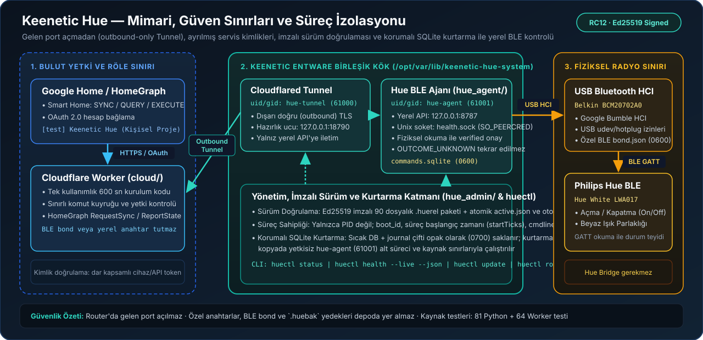

# Architecture and Trust Boundaries

A Google Home command arrives at the Cloudflare Worker through the user's personal
development integration. The Worker manages OAuth account linking and the command
queue, communicating with the local endpoint on the Keenetic router over a
router-initiated outbound Cloudflare Tunnel. On the router, the Entware agent
controls the Hue lamp through a USB Bluetooth HCI adapter. HomeGraph state
reporting is verified independently.

| Layer | Responsibility |
| --- | --- |
| Google / Worker | Account linking, scoped command authorization, HomeGraph state reporting |
| Tunnel | Outbound network path to the local endpoint; not command authorization by itself |
| Manager (`hue_admin`) | Signed release verification, service principals/permissions, atomic slot selection, backup/recovery |
| Agent identity (`hue-agent`) | BLE GATT operations and the local command journal database |
| Physical world | Lamp mains power, USB adapter, radio link, and external power switches |

A PID number alone is not proof of process ownership: boot identity (`boot_id`),
process start time (`startTicks`), command-line arguments, and the expected UID/GID
principal are verified together. Logs are bounded; if no terminal signal record
exists, the termination cause is reported as unknown rather than fabricated.
Accepting a command into a queue does not mean physical completion: `verified`
requires final GATT readbacks to match all requested state fields. An uncertain
physical outcome is recorded as `OUTCOME_UNKNOWN` and is never automatically
replayed.

If a hot SQLite rollback journal remains after an unexpected stop, `root`
preserves the original database and journal pair together as opaque private files
(`0700` directory / `0600` files) before any recovery attempt. Recovery runs
exclusively on a staged copy under the dedicated `hue-agent` identity with strict
resource limits. Canonical state is never replaced until schema and integrity
checks pass, and a new database is never paired with a stale rollback journal.
During joint startup, Tunnel startup is skipped if agent startup fails.

RC12 passed live command and router reboot acceptance on the existing personal
installation. This does not pre-certify fresh cloud accounts or every possible
hardware interruption. The initial historical supervisor disappearance trigger
was unrecorded and remains unknown; the proven fix addresses the recovery deadlock
and lifecycle diagnostic gap.
